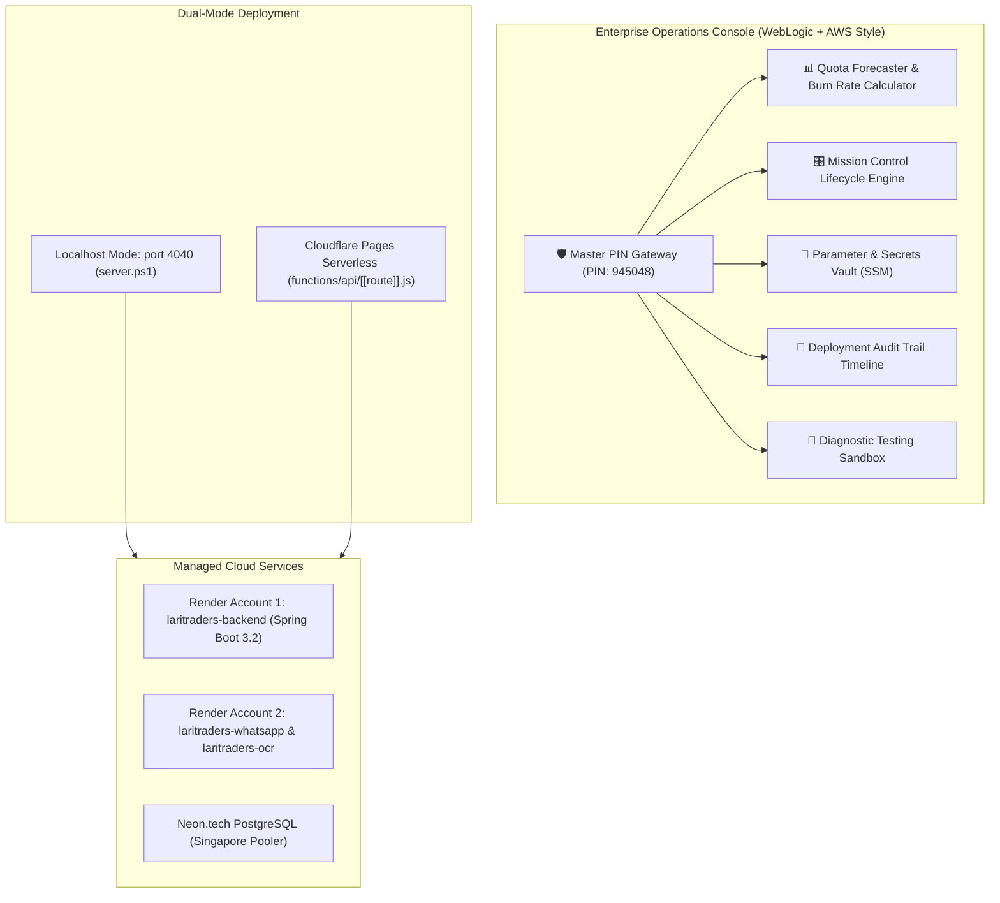

# ⚡ Lari Traders — Enterprise Cloud Operations Console (V2)

Enterprise-grade operations, governance, and observability console for FMCG Shop microservices and multi-account cloud infrastructure. Inspired by **Oracle WebLogic Administration Console** and **AWS Systems Manager / CloudWatch**.

---

## 🏛️ System Architecture



---

## 🚀 Key Features

### 1. 🛡️ Master PIN Security Gateway
* Dedicated security gate protecting sensitive cloud operations.
* Default Master Access PIN: `945048` (configurable).
* Automatic session locking and remember-me support.

### 2. 📊 Multi-Account Quota Forecaster
* **Account 1 (`arhaanmashkoor9@gmail.com`):** Dedicated backend instance ($\le 744\text{ h/mo} \le 750\text{ h free limit}$). Guaranteed 0-shutdown risk.
* **Account 2 (`mashkooralam154@gmail.com`):** Dedicated microservices cluster with live hours tracking and Scale-to-Zero capability.

### 3. 🎛️ Mission Control Lifecycle Engine
* **1-Click Redeploy:** Standard and clean-cache redeploys.
* **1-Click Restart:** Instant signal delivery to running instances.
* **Scale-to-Zero (Suspend / Resume):** Suspend WhatsApp or OCR at night with 1 click to preserve 100% of free hours.

### 4. 🔑 Centralized Parameter & Secrets Vault
* View and edit environment variables live on Render without opening the Render dashboard.
* Masked values with Eye reveal toggle.
* Add, remove, and commit changes with a single button.

### 5. 📜 Deployment Audit Trail
* Live timeline of the last 8 build, deploy, and restart events directly from the Render API.

### 6. 🧪 Diagnostic Playground
* Live Gemini 2.5 Flash prompt execution with latency measurement.
* WhatsApp Baileys WebSocket heartbeat ping.

---

## 🏃 Running Locally

Double-click `start-dashboard.bat` or run:
```powershell
powershell -NoProfile -ExecutionPolicy Bypass -File server.ps1
```
Open [http://localhost:4040](http://localhost:4040) in your browser.

---

## ☁️ Deploying to Cloudflare Pages (24/7 Live)

1. Open [dash.cloudflare.com](https://dash.cloudflare.com).
2. Go to **Workers & Pages** > **Create** > **Pages** > **Connect to Git**.
3. Select repository: `Arhaanx5/cloud-ops-console`.
4. Configure:
   * **Framework preset:** `None`
   * **Build output directory:** `public`
5. Click **Save and Deploy**.
